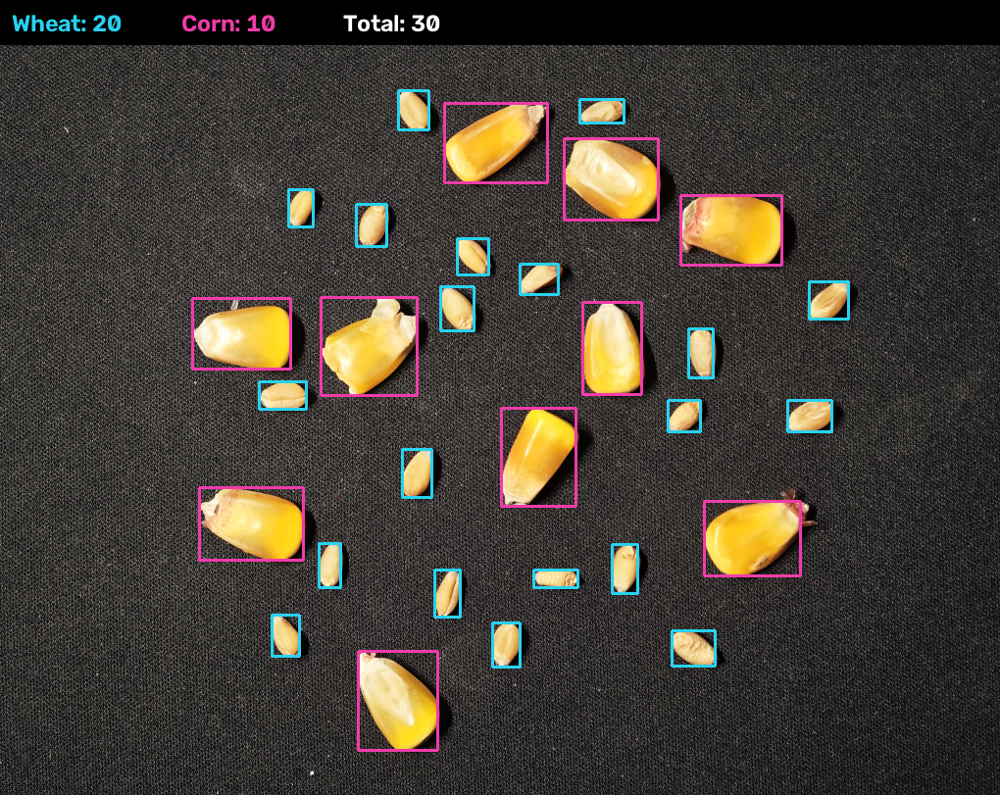

# 项目二 基于光电成像方法的自动计数

《光电图像处理》本科课程项目。将小麦和玉米平铺在黑色鼠标垫上，用台灯照明、手机 3.2 倍长焦俯拍。程序从照片中提取谷粒轮廓，按投影面积区分两种谷物，并在每粒周围画框。下图是混合样图的实际输出，青框为小麦，粉框为玉米。



## 运行

在仓库根目录执行以下命令，安装依赖并处理全部三张样图。

```shell
python -m pip install numpy opencv-python
python grain_count.py
```

终端会输出每张照片的小麦数和玉米数。程序默认读取 [样图](样图/) 目录中的 JPG 文件，在 [结果](结果/) 下为每张照片建立同名子目录，依次保存灰度图、滤波图、二值图、面积筛选图和带框计数图。

也可以指定一张或多张照片，用 `--output` 选择结果目录。例如，只处理混合样图并将结果另存到“本次计数”：

```shell
python grain_count.py "样图/03_混合_小麦20粒_玉米10粒.jpg" --output "本次计数"
```

## 算法

1. **灰度化与滤波。** 将照片按比例缩放至长边 1020 像素，转为灰度图，用 5 × 5 高斯滤波减弱鼠标垫细纹。
2. **前景分割。** 对每张图用 Otsu 法自动选取灰度阈值，将较亮的谷粒与较暗的背景分开。
3. **逐粒定位。** 对二值图做八连通域标记，计算每个区域的像素面积。剔除小于 100 像素的区域，用保留区域的外接矩形标记颗粒位置。
4. **分类计数。** 在两张纯样图中，最大小麦为 1087 像素，最小玉米为 3041 像素。取两者的中点 2064 作为分类界限。保留区域小于该值时计为小麦，达到或超过该值时计为玉米。

## 样图结果

| 样图 | 小麦（粒） | 玉米（粒） | 总计（粒） |
| --- | ---: | ---: | ---: |
| [纯小麦](结果/01_纯小麦_30粒/05_计数.png) | 30 | 0 | 30 |
| [纯玉米](结果/02_纯玉米_20粒/05_计数.png) | 0 | 20 | 20 |
| [混合](结果/03_混合_小麦20粒_玉米10粒/05_计数.png) | 20 | 10 | 30 |

两张纯样图用于确定面积界限，混合图用于检验该界限。三张图的分类计数均与逐粒目视核对结果一致。

## 用自己的照片计数

选用深色背景，让谷粒完整入镜，彼此留出空隙。两粒谷物在二值图中连成一片时，程序可能只画一个框并少计一粒。遇到这种情况，可以先查看输出中的 `03_二值.png` 和 `04_面积筛选.png`，确认相邻颗粒是否已分开。

拍摄高度、裁剪范围或谷物品种发生变化时，单粒在处理图中占据的面积也会变化。可在新条件下各拍一张纯小麦和纯玉米照片，重新测量面积范围；若两类仍有间隔，用新的中点更新 [grain_count.py](grain_count.py) 中的 `CORN_AREA`。
